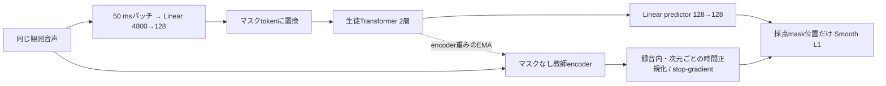

# 直接パッチencoderの潜在予測SSL

2026年11月2日 JST。今後のSSL目的は②の**潜在予測のみ（`latent`）**を採用する。音響復元の補助項は加えない。[10,000更新の比較](audio-ssl-objectives-10k-report.ja.md)で全指標の優位が確定したわけではなく、構成の単純さを含めた採用方針である。本書は現在の実装を説明するもので、学習の追加実行は行っていない。

## 生徒と教師が見るもの

生徒encoderを $f_\theta$、教師encoderを $f_\xi$、学習用predictorを $q_\phi$ とする。教師は生徒encoderのコピーで初期化し、以降はEMAだけで更新する。外部の事前学習済みモデルではない。

入力は48 kHz・2 ch、最大4秒。50 msごとの左右各2,400サンプルを、左→右の順に4,800要素へ連結し、直接128次元に投影する。Transformerも幅128・2層・4 heads、FFN幅352。出力は20 FPS・128次元で、CNNや時間平均による間引きはない。

生徒だけが投影後のtokenを隠す。完全な50 msパッチの約40%を採点対象に選び、基本のmask spanは4 token（200 ms）。さらに各採点位置の前後1 tokenも隠すguardを、比較実験から引き継いでいる。したがって実際に隠す範囲は40%より広くなり得るが、lossは元の採点maskだけに掛ける。guardはCNN対照条件に由来し、直接パッチで必須と確認された設定ではない。

教師は同じ観測音声をマスクなしで見る。今回のレシピには人工的な音声混合・別crop・ノイズ追加はない。元データの背景音まで除去した「クリーン音声」を作っているわけではない。双方向Transformerなので、教師の各位置の出力には前後の文脈も含まれる。

## 教師の予測対象

教師encoderの最終出力を $h^T_{btd}=f_\xi(x)_{btd}$ とする。$b$ は録音、$t$ は時間、$d$ は特徴次元。録音 $b$ の完全な有効パッチ集合 $V_b$ に沿って、各次元を標準化する。

$$
\mu_{bd}=\frac{1}{|V_b|}\sum_{t\in V_b}h^T_{btd},\qquad
\sigma_{bd}=\sqrt{\frac{1}{|V_b|}\sum_{t\in V_b}(h^T_{btd}-\mu_{bd})^2}
$$

$$
y_{btd}=\operatorname{stopgrad}\left(
\frac{h^T_{btd}-\mu_{bd}}{\max(\sigma_{bd},0.1)}\right)
$$

分散は母分散で、分母は`std.clamp_min(0.1)`。`sqrt(var + epsilon)`やベクトルのL2正規化ではない。小さな変動を過度に増幅しないために下限を設ける。padding・末尾の不完全パッチは統計とlossから除外し、その教師targetは0にする。ただしencoder自体の文脈には末尾の部分tokenが入る場合がある。

この時間平均は正規化の統計計算であり、時間方向を潰すpoolingではない。正規化後も各時刻の128次元表現を保持する。教師の最終層出力だけを使い、複数層の平均は使わない。

## 最小化する損失

生徒のマスク付き出力へ線形predictor（biasあり）を掛け、$p=q_\phi(f_\theta(x;M))$ とする。誤差 $e=p-y$ に対して`torch.nn.functional.smooth_l1_loss`を使う。現在の $\beta=1$ では、1要素のlossは次の形になる。

$$
\ell(e)=
\begin{cases}
\frac{1}{2}e^2 & |e|<1 \\
|e|-\frac{1}{2} & |e|\geq1
\end{cases}
$$

小さな誤差には二乗、大きな誤差には線形のペナルティを掛ける。大誤差で勾配が増え続けるMSEより影響を抑えられる。cosine lossではなく、正規化した教師表現の各座標へ近づける回帰である。

ドメイン $g$ の採点位置集合を $M_g$、次元数を $D=128$ とすると、

$$
L_g=\frac{1}{D|M_g|}\sum_{(b,t)\in M_g}\sum_{d=1}^{D}\ell(p_{btd}-y_{btd}),\qquad
L=\tfrac12L_{\mathrm{music}}+\tfrac14L_{\mathrm{en}}+\tfrac14L_{\mathrm{ja}}
$$

通常のbatch 8は音楽4・英語2・日本語2。それぞれの群内の採点フレームで平均した後、音楽と発話全体を1:1にする。同じ群内では録音ごとの等重みではなく、採点フレームごとの等重み。群が欠ける場合は存在する群の係数合計で再正規化する。

`latent`の係数は1.0で、これが学習lossの全体。スペクトル復元、energy、左右差、クラスタCE、対照学習の負例、MIDI・文字起こしラベル、明示的な分散・共分散ペナルティは加えない。比較用の補助headはcheckpoint互換のため構造に残るが、潜在のみではforward・勾配計算・更新に使われない。従来のクラスタheadも凍結・未使用である。

## EMAとoptimizer

生徒encoderとpredictorをoptimizerで更新した後、教師encoderだけを次式で更新する。predictorは教師へコピーしない。

$$
\xi\leftarrow\tau_s\xi+(1-\tau_s)\theta,\qquad
\tau_s=0.99+0.009\min(1,s/1000)
$$

$s$ は0始まりの更新index。第1更新は0.99、第1,000更新は0.998991、第1,001更新以降は0.999。後半は新しい生徒重みを0.1%ずつ取り込む。教師は勾配なし・evalモード・FP32で保持する。固定教師ではなく、生徒よりゆっくり変化する学習目標である。

| 設定 | 現在値 |
| --- | --- |
| Optimizer | AdamW、betas=(0.9, 0.999)、eps=1e-8、weight decay=0.01 |
| LR | $3\times10^{-4}\min(1,(s+1)/50)$。50更新warmup後は一定 |
| 勾配clip | 全体のL2 norm上限1.0 |
| 精度 | CUDAではBF16 autocast、パラメータ・教師target正規化・loss・EMAはFP32 |
| loss | Smooth L1、beta=1、潜在項係数1.0 |

AdamWのweight decayはoptimizer側の処理であり、TensorBoardの`loss`へ別の正則化項として加算していない。教師target計算は勾配を止めるため、逆伝播で動くのは生徒encoderとpredictorだけである。

## 何が学べているかの確認

目標は、隠した区間を周辺文脈から予測できる表現の学習。波形そのものの復元ではなく、ピッチ・onset・位相・音量などをすべて保持する保証はない。EMA・mask・正規化を使っても、表現崩壊が数学的に排除されるわけではない。

TensorBoardの`teacher_std`は**正規化後のtarget**の採点位置で測る値なので、これだけで崩壊していないとは判定しない。凍結encoderの音響クラスタprobe・MIDI押下probe、無音置換、特徴の分散・有効rankなども併せて確認する。SSL lossの低下だけを採譜やASRの改善と見なさない。

これはdata2vecに着想を得た簡略実装で、WavLM・M2Dなどの論文レシピをそのまま再現したものではない。現在の検証データは音楽・英語・日本語で、環境音の学習・評価は未実施である。

## 採用後の操作と再利用

`experiments/run_ssl_objectives.py train`は`--objective`省略時も`latent`を選ぶ。新しいplanを`prepare`で作成した後、`train --objective latent`で単独学習する。既存の`suite`と`evaluate`は③・②・学習前を揃える比較専用であり、潜在のみの単独実行には使わない。共通の`prepare`には補助lossの校正も残るが、`latent`の更新中は音響targetを計算しない。codebookは共通評価用で、潜在lossの教師には使わない。

実装hashを保存する実験なので、古いplanに新コードを混ぜず、新規学習には新しい出力先・planを作る。過去の厳密再現・継続では記録された実装revisionを使う。

推論で再利用するのは**生徒encoderのマスクなし20 FPS表現**。EMA教師とpredictorは学習用であり、通常の特徴抽出には不要。旧LLM課題のencoder経路への接続変更や、LLMとの追加学習は今回の採用だけでは行われない。

実装: [損失・教師・EMA](../src/creative_agent/ssl_objectives.py)、[encoder](../src/creative_agent/representation.py)、[学習経路](../src/creative_agent/ssl_objective_training.py)、[mask作成](../src/creative_agent/representation_data.py)。
