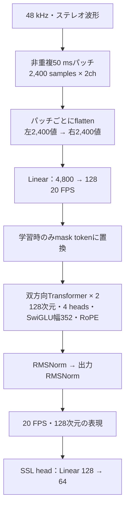

# 波形パッチの線形埋め込みから直接Transformerへ渡す

`patch20`は48 kHzステレオ波形を非重複50 msパッチに分け、各パッチの4,800値（左2,400 samples、その後に右2,400 samples）を1回の線形投影で128次元へ写す。CNN・前段の活性化・平均プーリングを使わず、20 FPSで既存の双方向Transformerへ渡す。



数学的にはkernel＝stride＝2,400の全結合Conv1dと等価だが、実装は波形のパッチ化と`Linear`のみである。パッチ内部の時間順序と左右の区別を保つ。既存の`early_concat`は10 msパッチの960→32投影、SiLU、32→128投影を経て5フレームを連結・投影しているので、その前段を省いた比較になる。

投影層は614,528パラメータ、SSL headを含む全体は1,025,216。対照`early_concat`は527,712であり、同じモデルサイズの比較ではない。Transformerの幅・深さを変えず、パラメータ数・処理時間・メモリを併記する。

## 固定する比較

実音楽・英語・日本語の同じsource分割を使う。各条件1,000更新・3 seed（20261102／20261103／20261104）、計6,000更新。最大4秒、batch 8、群比率2:1:1、trainのみでfitした64クラスタ、LR 3e-4・warmup 50・AdamW・BF16 autocastを共通にする。seedごとのTransformer・mask token・headの初期値、教師、音声区間、donor、SNR、maskを揃える。testは最終更新だけで評価する。

非重複のパッチ投影は対象窓の外へ情報を伝えないが、比較では対照と同じ前後1位置のmask保護範囲を維持する。元波形の有効長外をゼロ化し、末尾の不完全パッチは表現として返すが教師lossからは除外する。パッチ順序、左右・時刻ごとのsample値の保持、padding、mask窓からの情報漏れ、勾配、保存と厳密再開をテストする。

## 実行

まず`patch20`だけを8更新してスモークを確認する。

```sh
uv run --no-sync python experiments/run_ssl_comparison.py suite \
  --manifest data/public-audio-20261101/manifest.json \
  --suite runs/audio-patch20-smoke-20261102 \
  --recipe recipes/audio-patch20-smoke.json \
  --variants patch20 --steps 8 --seeds 20261102
```

本比較は新しい出力先で両条件を実行する。

```sh
uv run --no-sync python experiments/run_ssl_comparison.py suite \
  --manifest data/public-audio-20261101/manifest.json \
  --suite runs/audio-patch20-comparison-20261102 \
  --variants early_concat patch20 --steps 1000 \
  --seeds 20261102 20261103 20261104

uv run --no-sync python experiments/audit_ssl_comparison.py \
  --manifest data/public-audio-20261101/manifest.json \
  --suite runs/audio-patch20-comparison-20261102 \
  --summary runs/audio-patch20-comparison-20261102/audited-summary.json
```

TensorBoardは全更新の学習曲線、各validationの指標・正解／予測画像を維持し、繰り返し同じ音声を保存する容量を抑えるため、音声は最終validationとtestで記録する。checkpoint・export・元の評価予測・codebook・plan・ログはGit除外対象のrunへ保存する。パラメータを持たない`reducer=Identity`は監査の更新検証から除外し、投影層・Transformer・headの更新を検証する。

この比較はencoder単体の固定音響クラスタに対するSSLであり、LLMを含む文字起こし・採譜の性能評価は別段階になる。
