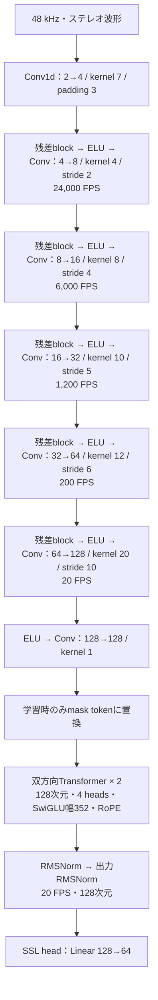

# 波形CNNで20 FPSへ圧縮してからTransformerへ渡す

48 kHzステレオ波形を5段の残差CNNで20 FPSへ落とし、幅128・4 heads・2層の双方向Transformerへ渡す`seanet20`を追加した。時間方向の平均プーリング、フレームの明示的な連結、LSTMは使わない。

[ELUでの6 run・6,000更新の比較結果](audio-seanet20-report.ja.md)を参照。動作検証は通ったが、今回の小型構成は音声入力への依存が弱く、対照の`early_concat`を上回らなかった。

[EnCodecのSEANet encoder](https://github.com/facebookresearch/encodec/blob/main/encodec/modules/seanet.py)の残差ブロックと段階的なstrided convolutionを参考にした独立実装で、事前学習済みEnCodecの重みは使わない。元実装の4段・320倍圧縮に対して5段・2,400倍とし、ゼロpadding・恒等残差・末尾kernel 1の投影を使う。公式48 kHz版と同じ構成や性能を主張するものではない。

## 構成



各残差blockは`x + Conv1(ELU(Conv3(ELU(x))))`。枝内ではチャネルを半分にしてから戻す。波形CNNの全ConvにWeightNormを使い、時間方向の統計は集約しない。初段幅は`seanet_base_width`で指定する。図とスモークrecipeは4。

strideの積は`2 × 4 × 5 × 6 × 10 = 2400`で、48,000 / 2,400 = 20 FPS。4秒は80、30秒は600、60秒は1,200トークンになる。末尾の投影はkernel 1なので20 FPSになった後の局所受容野を広げない。

paddingを含む前段の受容野は5,678サンプル（約118.3 ms）。出力位置nは`[2400n−1643, 2400n+4034]`の元音声だけに依存する。50 ms教師窓の情報が届く出力は自身と前後1位置に収まるため、既存の前後1位置のmask保護範囲を共用できる。録音の先頭・中央・末尾で、maskした窓の波形を書き換えてもTransformer入力が変化しないことを検証する。

可変長バッチでは元波形・初段出力・各段の残差後／圧縮後に有効長外をゼロ化する。バイアスによって生成されたpadding領域が、次段の畳み込みで有効領域へ戻るのを防ぐ。末尾の不完全な50 ms窓は表現として返すが、教師lossからは除外する。

## 比較と実行

比較対象は`early_concat`。Transformer・headの初期重み、教師、sampling順、mask、音声混合、学習率、更新数を揃える。CNNのstemは構造が異なるため共通初期値とはしない。パラメータ数・速度・メモリを記録し、同じ更新数を同じ計算量とは扱わない。

まず実音楽・英語・日本語を使った各8更新のスモークを実行する。この段階では優劣を判断しない。通常の1,000更新・3 seed比較は、既存のrecipeと別の出力ディレクトリで同じ2条件を指定できる。

```sh
uv run --no-sync python experiments/run_ssl_comparison.py suite \
  --manifest data/public-audio-20261101/manifest.json \
  --suite runs/audio-seanet20-smoke-20261102 \
  --recipe recipes/audio-seanet20-smoke.json \
  --variants early_concat seanet20 --steps 8 --seeds 20261102

uv run --no-sync python experiments/audit_ssl_comparison.py \
  --manifest data/public-audio-20261101/manifest.json \
  --suite runs/audio-seanet20-smoke-20261102 \
  --summary runs/audio-seanet20-smoke-20261102/audited-summary.json
```

`--variants`を省略したsuiteは従来の3条件を維持する。新しいplanには選んだ条件を記録し、学習・監査がその条件を使う。保存形式は既存と同じで`variant=seanet20`から再構築する。過去のrunは書き換えず、新しい実行先で教師・計画・重み・TensorBoardを保存する。

TensorBoardには既存経路と同様にloss、勾配、混合例数、群別評価、入力音声と教師／予測画像を記録する。今回の変更範囲はencoder単体のSSL経路であり、LLM接続・文字起こし・採譜の再学習は別段階になる。
