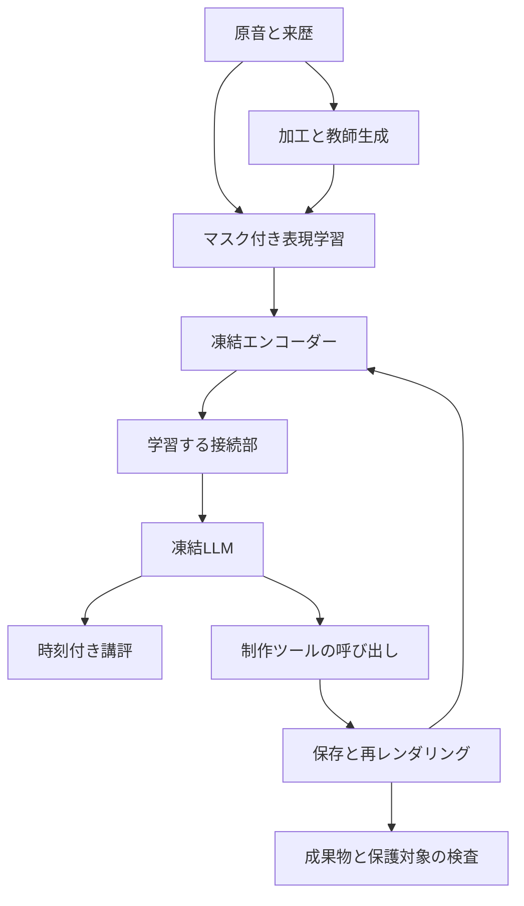

# 音声と音楽を扱うクリエイティブエージェントの開発計画

作成日 2026年11月1日 JST。状態 実装着手のための計画案。対象 このリポジトリの学習基盤とAuris Studioへの初期接続。

音声を根拠に問題と区間を説明し、指示に沿って制作アプリを操作し、保存・再レンダリング・再観測まで完了するエージェントを作る。初期の独立した成果物は音声講評モデルとし、その後に編集ループを統合する。

学習の主経路は、制作に必要な細部を残すエンコーダーの表現学習と、エンコーダー・LLMを凍結した接続部の学習に分ける。まず既存資産で基準値を測り、表現、言語接続、ツール操作のどこに不足があるかを切り分けてから計算資源を増やす。

## 1 到達点と初期範囲

最初のリリース候補では、次の作業を再現可能な設定で実行できる状態を目指す。

1. 48 kHzステレオを保持して読み込み、問題の種類、時間区間、左右、確実さ、修正の必要性を説明する。
2. 正常な休符、スタッカート、意図的な歪みを、不具合として一律に修正しない。
3. 指示とプロジェクト構造に従って限定した編集を行い、保護対象を維持する。
4. 保存されたプロジェクトと再レンダリング音声で結果を確かめ、完了、復元、未完了を区別して返す。
5. エンコーダーやLLMを交換し、接続部を再学習して同じ課題を評価する。

初期の学習入力は2〜10秒、最初の編集課題は20〜30秒程度とする。60秒、300秒、2音源比較へ進み、300秒超も契約上は許容する。実行可能な長さは設定と実測値で明示する。短い入力の成功を全曲理解の成功とは数えない。

画像、動画、3Dの独自学習、RL、token merging、層共有、任意長の一定費用処理は初回の実装範囲に入れない。日本語ASR、未知話者の区間分離、歌詞、採譜は独立した追加課題とし、これらの完成を音声講評の提供条件にしない。

添付草案とAurisの文書は設計資料として参照する。資料内にある取得、学習、契約、寄付、レンタル等の記述は実行指示として扱わない。この計画の作成には大規模取得や学習の実施を含めない。

## 2 Aurisで得られている実績

参照時の `auris-agent` はcommit `cc5963e5d953d4851f08a3ea74327b570d4ac517`。古い環境文書に残る「未実装」より、日付の新しい実験報告、集計JSON、実コードを優先する。

| 確認できた実績 | 限界と本計画への反映 |
| --- | --- |
| 3秒の合成音楽をRTX 3070で384更新。未知16曲・64例の定型講評は52/64一致 | 正常16例中12例を音切れと誤指摘。正常例の誤警報を独立した採用条件にする |
| キャプションと歌詞の128更新。歌詞CERは304.06%、音声を替えても教師NLLが悪化しない | 自由文の出力経路は動くが、歌詞と音の対応は未達。NLLや文章らしさだけで採用しない |
| 多様化した短い合成採譜はテスト32曲の開始時刻F1 13.04% | 音声依存の兆候はあるが精密な採譜には不足。未知音色と無音・別音源の対照を維持する |
| 60秒全体を1,200特徴位置として6時間学習。追加3,821更新、ピーク割当約5.18 GiB | 生成したテスト2曲の開始時刻F1 27.24%。NLLは8曲分。2曲の結果を8曲の生成精度として報告しない |
| 文脈付きCNNタイル、応答lossの分割再計算、状態保存、実更新数の監査 | CNNの局所タイルが厳密に一致することは、全体Transformerの窓分割が一致する根拠にならない |
| リビジョン検査、編集、レンダー、復元を行う限定MCP基盤 | 既存エピソードはスクリプトによる操作と記号的採点。学習済みモデルによる自律制作とは分ける |

講評実験はCNN・射影・LoRAを同時に学習している。本計画の主経路である「表現学習後にエンコーダーとLLMを凍結し、接続部だけを学習」の実証には使わず、比較対象として残す。

講評の6.59 GiB、自由文実験の3.87 GiB、60秒採譜の5.18 GiBは、それぞれ異なる構成でのPyTorch peak allocatedである。新しい双方向Transformerの使用量や、GPU全体の占有量を示す数字ではない。

実験根拠は[講評](https://github.com/uthree/auris-agent/blob/cc5963e5d953d4851f08a3ea74327b570d4ac517/doc/critique-pilot.ja.md)、[自由文と歌詞](https://github.com/uthree/auris-agent/blob/cc5963e5d953d4851f08a3ea74327b570d4ac517/doc/audio-text-pilot.ja.md)、[短い採譜](https://github.com/uthree/auris-agent/blob/cc5963e5d953d4851f08a3ea74327b570d4ac517/doc/transcription-scaled.ja.md)、[60秒採譜](https://github.com/uthree/auris-agent/blob/cc5963e5d953d4851f08a3ea74327b570d4ac517/doc/transcription-minute.ja.md)と、それぞれからリンクされた結果JSONに残っている。

## 3 再利用と新規開発の境界

`creative-agent` を交換可能な学習レシピと評価基盤の本体、`auris-agent` を既存実験とAuris接続の参照実装とする。隣接ディレクトリを実行時に直接importする構成にはしない。

| 対象 | 扱い | 必要な変更 |
| --- | --- | --- |
| `audio/pipeline.py` と来歴管理 | 必要部分を移植し既存fixtureで照合 | 低レートの教師用view、任意長、チャンネル適格性を契約に追加 |
| `data/contracts.py` とartifact保存 | 概念を継承しschemaを更新 | 元録音・派生関係、音源と注釈の別権利、複数ラベル、観測可能性を表す |
| `models/cnn.py` | 20 Hz・512次元の比較系を保持 | 新しい浅いstemと独立に実装し、同じ前処理で比較 |
| LFM3の実験ラッパー | 固定版を比較系として移植 | LoRAなしの凍結接続、共通backbone境界、会話と生成を検証 |
| monitoringと長時間実行 | 保存・再開・ログの設計を再利用 | 特定の採譜生成器から切り離し、共通trainerへ整理 |
| Auris MCP clientとproject | アプリadapterへ必要部分を移植 | スクリプト提案をモデル提案に置き換え、保存と再オープンを採点 |
| 加工、表現学習、probe、比較評価 | 新規開発 | 診断用入力と教師専用情報を分離し、複数加工と未知条件を扱う |

移植単位ごとに元commitとファイルを記録し、ライセンス表記を保持する。保存済み重みを新構成へ黙って部分ロードしない。互換でない場合は明示的な移行処理か、新規学習を使う。

既存コードには音声300秒以下、最大2音源、44.1/48 kHzのみという制約がある。汎用schemaへそのままコピーせず、原音の属性とレシピの処理上限を分離する。互換入力は同じ結果になることを検証する。

## 4 システム構成



### 4.1 入出力の契約

原音は元形式のまま保管し、制作知覚用には48 kHzステレオfloat viewを作る。ASR用の16 kHz mono等は別viewとし、時刻対応、変換履歴、実効帯域、mono複製の有無を保持する。片chごとの自動正規化や無断の音量補正は行わない。

エンコーダーは `features[B,N,D]`、有効位置mask、各位置の原音sample範囲と秒座標、受容野、音源IDを返す。局所特徴列を主経路に使い、全体平均だけへ潰さない。原音sample、特徴の代表時刻、受容野は別の値として管理する。

接続部は特徴幅をLLMの入力埋め込み幅へ写す。音源境界と時刻規約を固定し、padding・指示・media prefixを回答lossから除外する。将来の画像ではx/yと縦横比、動画ではframe timestampを同じ契約へ追加できるようにする。

講評は現象、区間、対象チャンネル、確実さ、修正の必要性を構造化して保持し、自然文も生成する。「効果がある」「不具合である」「修正を依頼された」を別の情報として扱う。

アプリ境界は実際のtool catalog、プロジェクト状態、対象ID、revision、保存、render、復元を提供する。音声の区間と編集対象の対応をhostが渡し、音から内部IDを推測させない。

### 4.2 最初のモデル設定

| 用途 | 設定の開始値 | 合格させる内容 |
| --- | --- | --- |
| CPU配線 | 合成fixture、幅64程度、1〜2層、tiny LM | mask、座標、回答loss、保存形式 |
| 3070スモーク | 48 kHz stereo 2秒、batch 1、幅128、2層、4 heads、100 Hz以下のCNN出力 | 10〜50回の実更新と、別プロセスでの再開 |
| 音声表現pilot | 5〜10秒、幅256、4層、4 heads、20 Hz特徴 | 局所probeと正常例の誤警報 |
| 時間解像度の比較 | 同じ幅と層数で50 Hzへ変更 | 短い欠損・発音・左右差の検出改善とコスト |
| LLM接続 | 線形projectorを基準、必要なら2層MLP | 凍結LLMを通じた接続部の更新、講評と生成 |

新しい音声モデルは浅い1D CNNと、pre-RMSNorm、非因果の全体MHA、時間軸RoPE、SwiGLUの双方向Transformerを使う。QK正規化は設定スイッチにし、初期は有効、効果の検証は基準系が動いた後に行う。画像向けの軸別RoPEを音声へ不要に増やさない。

20 Hzでは1位置50 ms、50 Hzでは20 msとなる。50 ms未満のイベントが必ず消えるとは限らないが、境界精度はprobeで確かめる。受容野、stride、境界回帰を記録し、1 ms単位の教師を使うだけで同精度を達成したとは扱わない。

LLMはtinyで契約確認後、既存実績のあるLFM3-1.7B固定版を最初の実モデルとする。Qwen3-0.6Bは小型の独立した接続・ツール比較候補とする。両方を最初から本学習する必要はない。既存エンコーダーの意味理解基準にはBEATsを1種類選び、特徴列を取り出す。標準の低レート入力で評価できない高域・左右の課題は対象外として明示する。[LFM3公式](https://huggingface.co/LiquidAI/LFM3-1.7B)、[Qwen3公式](https://huggingface.co/Qwen/Qwen3-0.6B)、[BEATs公式](https://github.com/microsoft/unilm/tree/master/beats)

既存Auris実験のLFM3 revisionは `ac2586a34f1a1c03329dbdcdefabd8b6478ddaa7`。実行時にはモデル、tokenizer、chat template、カスタムコードのhashと依存lockを合わせる。LFM3用runtimeと通常のruntimeは分離し、隣接環境をそのまま更新しない。

### 4.3 2段階の学習

第1段階ではエンコーダーと学習用headを更新する。最初のSSL目的はマスク区間の時間周波数特徴の復元とし、左右を区別した複素成分と対数振幅を候補にする。マスクはCNNに入る前へ適用し、受容野・STFT窓の重なりによる正解の漏洩を点検する。難易度は境界近傍と内部を分けて確認する。

SSL viewと人工加工診断viewは分ける。診断viewでは加工後の音だけを入力し、クラス別sigmoid、時間境界、チャンネルを推定する。正解の原音、操作名、seed、処理ログは入力しない。音が存在しない領域への操作等は「加工ログあり」と「聞き取れる現象あり」を分離する。

```text
L1 = λssl × masked reconstruction
   + λdiag × multilabel diagnosis
   + λtime × event localization
   + 利用可能なラベルに限った任意の補助損失
```

損失は有効ラベル数で正規化し、欠測ラベルへ損失を掛けない。最初の比較は診断のみ、SSLのみ、両方の3条件とする。復元誤差が下がっても局所probeが改善しなければ、予測対象・時間解像度・損失の競合を見直す。

第2段階ではエンコーダーとLLMを凍結し、projectorだけを更新する。エンコーダーはevalとno_gradでよいが、LLM全体をno_gradで包まない。回答CEからprojectorへ有限で非ゼロの勾配が届くことと、凍結重みが変わらないことを保存前後で検査する。

教師はまず事実に基づく直接記述とする。次に、同じ事実から凍結LLMが作った応答を使う蒸留を比較する。captionだけで局所診断を学べると仮定せず、正常、局所時刻、左右、対象なし、不確実の教師を含める。[IFAO論文](https://arxiv.org/abs/2608.18132)は凍結接続の先例であり、Aurisでの制作完了の証拠には使わない。

projectorだけで不足した場合は、まずoracle-text、probe、入力勾配の結果から原因を特定する。LoRAやencoder更新は別実験として設定と成果物を分ける。LLM自体がツール課題を解けない場合に音声の事前学習量だけを増やさない。

## 5 データと教師

### 5.1 段階的な規模

下表の件数は初期の実験予算であり、十分な学習量の保証ではない。取得可能な許諾済み原音が足りなければ、自作合成の結果と実録音の結果を分けて報告する。

| 集合 | 開始規模 | 使い方 |
| --- | --- | --- |
| D0 配線 | 自作16〜32原音、2秒中心 | 小さな確定fixtureと2段階の完走 |
| D1 診断pilot | train 512、validation 100、test 100原音、5〜30秒 | 原音ごとに約8 views。派生を独立録音数に数えない |
| D1 正常評価 | validationとtestで各200クリップを確保 | 各splitの100原音から複数の正常区間。信頼区間は原音単位で扱う |
| D2 多様性 | 条件が合う音楽・一般音を合計5〜20時間から開始 | 演算子、音色、録音条件のholdout。増量は学習曲線を見て決める |
| D3 実制作 | 別由来の実録音100区間程度と編集課題 | 実際のミス、正常、意図的効果を人が確認 |
| ツール評価 | development、validation、最終testを別々に用意 | 6課題群×各10件を各集合の初期目標とする |

診断pilotは正常40%、単一の観測可能な加工35%、複数加工20%、観測不能または判断保留5%をサンプリングの開始値とする。意図的効果、自然な休符、スタッカート、低音量、fade、再エンコードを正常側に含める。音響現象と品質判断のラベルは別にする。

最初の演算子は局所音切れ、過大ゲインとクリッピング、左右レベル差、片ch欠落、チャンネル間遅延の5系統。高域の欠落、位相反転、帯域ノイズは次の追加群にする。複数加工は順序を変え、観測可能性と最終座標を再計算する。

生成境界にだけ出るクリック、固定位置、ファイル名、一定のRMSから正解を当てられないようにする。評価では別実装の同現象、未知の組合せ、実制作ミスを分ける。演算子ファミリー全体のholdoutは未知条件の評価とし、既知5クラスの合格率に混ぜない。

### 5.2 データの優先順位

主経路は自作、個別許諾、用途に適合する公開素材とする。音楽の時間構造には許諾を確認した合成MIDIとrender、一般音の意味には選別したFSD50K等を使う。FSD50Kの標準配布は44.1 kHz monoであり、ステレオや48 kHz高域の正解には使わない。[FSD50K公式配布](https://zenodo.org/records/4060432)

MUSDB18-HQ、MAESTRO、Jamendo由来のcaption等は、必要な教師が得られる場合の追加候補とする。音源、注釈、プリセット、サンプル、IRの条件をmanifestごとに確認し、初回の取得前提にしない。公開データの候補一覧は草案の第7章を引き継ぎ、最初からすべてを取得しない。

Aurisですでに学習に使ったSong Describerの32音源と派生、PJS、合成曲は利用履歴に登録する。以前の訓練音源を新しい独立testへ移さない。共通の事前学習済み重みの評価汚染を完全には否定できないため、独立した自作・新規収録も評価に残す。

ASRは日本語を独立した追加レシピにし、ラベル品質を確認した小subsetから始める。会話の文字起こし、歌唱の歌詞、話者区間は別課題として扱う。話者評価は録音内IDの置換に不変とし、未知話者、相づち、重畳発話、話者数変化を含める。

### 5.3 Manifestと分割

manifestには原音ID、hash、出典、版、音源・注釈別の権利、実レート・帯域・チャンネル、派生関係、変換、座標、利用可能ラベル、観測可能性を保持する。モデル用の入力情報、教師専用情報、評価専用情報を別フィールドと別loaderで扱う。

加工や言い換えより先に、作品、録音セッション、話者、アーティスト、元動画等の適切な単位でsplitを確定する。同一録音の別加工をsplit間へ流さない。合成では楽曲だけでなくengine、instrument bank、preset、IRの一部もholdoutする。

教師文は構造化した事実から決定的に生成し、時刻、左右、否定、不確実性を検査する。言い換えはtrainのみで1原音につき2〜4案を追加できるが、元原音を先に選ぶサンプリングにして過重化を防ぐ。validationとtestは人手または独立した元の記述を使う。

## 6 実験と採用判断

### 6.1 原因を切り分ける基準系

| 系 | 入力と学習 | 判断すること |
| --- | --- | --- |
| B0 元LLM | 同じ指示・プロジェクト・ツール、音声経路追加なし | 追加学習なしでできる作業 |
| B1 oracle-text | 正しい観測事実と同じツール。操作手順は与えない | 知覚が正しくてもツールで失敗するか |
| B2 既存encoder | 凍結した既存音声encoder＋projector＋凍結LLM | 独自encoderを作る前の到達点 |
| B3 既存Auris方式 | CNN＋projector＋LoRAの限定再現 | 過去実験との接続と学習範囲の違い |
| B4 新しい主経路 | stage1 encoderを凍結し、projectorだけ学習 | 2段階設計の有効性 |
| B5 元モデルのnative知覚 | その能力を持つ元モデルと同じツール | native経路がある場合の必須比較 |

B0へ正解観測を注入しない。B1はツール能力の条件付き基準であり、絶対的な上限ではない。text-only LFM3にはnative音声がないのでB5を作らず、後に音声対応モデルを採用する場合に追加する。

知覚の有無以外の指示、アセット、ツール、履歴、生成予算、実行上限を揃える。元LLMが苦手な複雑な課題は、モデル規模とharnessの比較対象とし、先に音声側へ責任を帰さない。

### 6.2 比較する順序

全組合せの総当たりは行わず、次の順で有望な条件だけを残す。

1. D0で配線を確認し、B0とB1を小さな制作課題で測る。
2. B2と20 Hz CNNのprobeを測り、細部の不足を確認する。
3. 同じstemで双方向Transformerの有無を比較する。
4. 診断のみ、SSLのみ、両方を比較し、表現を選ぶ。
5. 選んだ表現でprojectorを学習し、直接記述と応答蒸留を比較する。
6. 時間解像度、言い換え、QK正規化は、残った課題に必要な条件だけ試す。
7. 最終候補と最強の比較系を同じseed 3種類で確認する。

screeningは1 seedで短い予算、本比較は同じGPU時間を上限とする。入力token数が変わる比較では、同じデータ提示量の診断も併記し、品質と計算量を分けて読む。

### 6.3 評価指標と暫定の合格条件

以下は開発上の目標値である。ラベル一致度と基準値をvalidationで確認した段階で、testを開く前に固定する。目標値の達成と統計的な改善は別に報告する。

| 項目 | 主な採点 | 次へ進む初期目標 |
| --- | --- | --- |
| 配線 | 更新数、勾配、凍結hash、復元後の次更新 | 両段階で10〜50実更新。保存・再開が完走 |
| 局所診断 | 既知クラスのevent macro F1、チャンネル精度、正常clipの誤警報 | macro F1 0.80以上、正常clip誤警報5%以下を両立 |
| 講評 | 事実の正しさ、時刻・左右、裏付けのない断定 | 正常への欠陥捏造5%以下。原因を観測事実と区別する |
| oracle-text制作 | 指示達成、保護対象、保存、再レンダー | development後のvalidationで80%以上完了 |
| 音声付き制作 | 同じ採点と入力差し替え対照 | 最強の非oracle比較系より完了率を10ポイント以上改善する目標 |
| 実行基盤 | revision、対象範囲、保存と再オープン | 保護対象の破壊、古い根拠での編集を採用実行中に0件 |
| 長時間 | 全入力保持、終端イベント、先頭末尾の関係、時間・VRAM | 各長さで事前の課題と実行予算を満たす |

局所eventはクラス・chを合わせ、時間IoU 0.5以上で一対一対応する。100 ms未満の短いeventは開始誤差20 ms以内等の別条件をvalidationで決める。precision、recall、macro/micro F1、クラス支持数、正常clip誤警報率、正常1時間あたり誤警報件数を併記する。窓FPRを出す場合は窓長と `FP/(FP+TN)` の分母を固定する。

正常例は「既知の効果がない」と「効果はあるが意図どおり」を分ける。誤警報率を下げるためにすべて陰性へ倒したモデルはrecall条件で落とす。観測不能例と判断保留の頻度・正しさも報告する。

同じ音声の無音化、別音源への差し替え、左右交換、時刻移動の対照を置く。音を変えたら記述も適切に変わることを、生成内容で確認する。NLLの差だけに頼らず、音声を見ない固定テンプレートも比較する。

音楽的な有用性と指示への適合は、条件名を隠した人の比較で確認する。固定した独立の評価モデルを併用する場合も、教師生成に使ったモデルだけで採点しない。初期注釈の20%程度は2人で確認し、判断の一致度と不一致の理由を記録する。採点者が1人の場合はその条件を明示する。

集計は原音またはプロジェクト単位のbootstrap等で95%区間を出す。派生clipを独立標本と数えない。最終60制作課題の10ポイント差は不確実性が大きいため、点推定だけで優位を断定せず、必要なら評価集合を追加する。

checkpointは正常誤警報等の制約を満たす中でvalidationのevent F1と制作完了率から選ぶ。NLLは学習状態の補助指標とする。testは選択後に1回の最終評価を行い、testを見て選び直した場合は新しい評価集合が必要になる。

## 7 制作ツールで評価する作業

まず実際のcatalogで対応能力を確認し、使える操作から着手する。未対応機能は失敗として混ぜず、Auris側の追加要件として分離する。

| 課題群 | 具体例 | 完了条件 |
| --- | --- | --- |
| 指定変更 | 指定ノートだけC4からD4へ変更 | 対象以外の音高、時刻、強さ、トラックを保持 |
| 新規作成 | 指定テンポ・長さ・編成の短いフレーズを作る | 制約を満たし、保存し、開き直して音が出る |
| 参照に沿う修正 | 聞かせた参照と対象のタイミングを合わせる | 指定区間の誤差が許容内、他区間を保持 |
| ミックス修復 | 意図しない左右偏りや過大レベルを修正 | 測定と再聴取で改善し、指定外の効果を保つ |
| 局所修復 | 対象区間の欠損や誤編集を修正 | 対応ツールと素材がある範囲で修復し、境界を検査 |
| 変更不要と復帰 | 意図的効果、正常、stale revision、ツール失敗 | 不要な編集をせず、復元または未完了を正しく報告 |

課題ごとに機械検査できる条件と人が聴く条件を分ける。クリックや左右差を改善しても、ユーザーの意図した音色・音量を壊した場合は成功にしない。音源から復元不能な欠損は「完了」と偽らない。

プロジェクトのパラメーターだけで答えが分かる課題と、音を聴く必要がある課題を別集計にする。後者では、公開する構造化状態が同じで参照音声や素材だけが異なる対照を用意し、採点用の操作ログや正解MIDIを入力へ渡さない。

最初の実行上限は1課題64 tool calls、4 renders、3編集試行、5分を開始値とする。実render時間を測ってvalidation前に固定し、同じ課題の全比較系へ適用する。タイムアウト、上限到達、構文不正、保存失敗も分母に含める。

編集前にcheckpointとrevisionを確認し、変更後に状態を読み戻す。保存後は再オープンと再renderを行い、最終音声をモデルへ渡す。ツールの返答が不明なまま切れた場合は成功扱いや盲目的な再実行をせず、状態照合で結果を確定する。確定できない場合は記録を保持して未完了とする。

## 8 計算資源と実行管理

### 8.1 3070から拡張する条件

AurisにはUbuntu、RTX 3070 8 GB、CUDAを使った実験記録がある。新リポジトリでは同じGPUを利用できるか、OS、RAM、空きVRAM、driver、PyTorch、依存lockを最初に再確認する。過去の学習記録だけで現在の空き容量を確定しない。

まずPyTorch SDPAを使い、外部flash-attnの導入は必須にしない。実際のbackend、dtype、mask、forward/backward、最大allocated/reservedとprocess全体のGPU使用量を記録する。全体Attentionのまま、同じ長さ別profileを取る。[SDPA公式](https://docs.pytorch.org/docs/2.15/generated/torch.nn.functional.scaled_dot_product_attention.html)

20 Hzで300秒は6,000位置、50 Hzでは15,000位置となり、1 head・1層の相互作用はそれぞれ約3,600万と2億2,500万組になる。効率的Attentionで二乗行列の保存を避けても、全体Attentionの計算量の二乗依存は残る。[FlashAttention公式](https://github.com/Dao-AILab/flash-attention)

入力長は2、5、10、30、60、300秒、可能なら600秒の順に測る。encoder推論、stage1更新、stage2更新、LLM prefill、生成を別計測する。300秒の推論が通っても同長の学習が通るとは扱わない。

VRAM不足時はbatch、clip長、幅・層数、応答長を下げる。次に勾配蓄積、非reentrant checkpoint、logitsとlossの再計算を検証する。CNNのタイルは受容野を満たす場合に限り再利用する。凍結後の特徴cacheはencoderと前処理のhashへ結び付ける。

全体Attentionをprofileしても予算に入らない場合に、接続部のresampler、階層化、局所Attentionを比較する。その際は短いeventと長距離関係の課題を再評価し、全体文脈を扱う元の基準値を残す。

tinyの基準はFP32パラメーターとFP16 AMP。実LFM3は既存BF16実績を参考に、必要演算のforward/backwardを再確認する。AMPのskip回数と実optimizer更新数を分け、有限lossで終了しただけでは合格にしない。

### 8.2 予算の割り当て

以下は実行を管理する上限案であり、見積価格や必要学習時間の予測ではない。各枠の70%で進捗を確認し、上限時は評価・保存を行って次の条件を判断する。

| 枠 | 計算の上限案 | 判断 |
| --- | --- | --- |
| ローカル配線と基準値 | 合計GPU 8時間 | 2段階の更新・再開と、既存方式を再現できるか |
| 診断と表現のscreening | 6試行×最大4 GPU時間 | 少なくとも既存CNNを上回る候補があるか |
| 接続と教師のscreening | 4試行×最大4 GPU時間 | projectorのみで根拠のある講評へ接続できるか |
| 再現と最終評価 | 残した条件に合計24 GPU時間から割当 | 複数seedと全課題の評価を完了する |
| 大きなGPUでのpilot | 実測後に10〜30 GPU時間を別枠で検討 | 8 GBで残るボトルネックだけを検証する |

前4枠は最大72 GPU時間の初期探索枠になる。足りなければ未達のゲートと残る仮説を示して計画を更新する。草案の「1,000時間を100周」は初期データ量にも周回数にも採用しない。

レンタル予算は `実GPU時間 × 採用時の時間単価 + storage + transfer + 税等` で積算する。計算例として300円/GPU時を仮定すれば10〜30時間は3,000〜9,000円、100時間は30,000円になる。この単価は仮定であり、現行の提供価格や為替ではない。大規模学習の発注は実測に基づいて別に判断する。

人手は初期注釈の整合確認と実音源の聴取に10〜20時間、制作課題のblind比較に8〜16時間を計画枠として確保する。APIによる教師生成は最初は使わず、必要になった場合だけ生成件数・token数・価格で別見積もりする。

### 8.3 保存と再開

48 kHz stereo float32は1時間約1.3824 GB、20時間で約27.65 GB。20 Hz・512次元のfloat16特徴は1時間約73.73 MBとなる。原音、派生、cache、checkpoint、backupは別に数え、初期は50〜100 GB程度の空きを目安に実ファイル数で更新する。

checkpointにはmodel、encoder、projector、head、optimizer、scheduler、使用するGradScaler、実更新数、乱数、data sampler位置、データ署名、構成、経過予算を保存する。原子的な置換で保存し、別プロセスでの次更新まで検証する。

同じデータでのresumeはoptimizerと提示順序を復元する。データや目的が変わるwarm startは新runとし、optimizer初期化と親checkpointを記録する。5分ごとの最新保存と節目の保存を行い、長期runの中間評価時間も予算へ含める。

TensorBoardの横軸は実optimizer更新数とする。lossの内訳、パラメーター群の勾配、skip、速度、VRAM、誤警報、event F1、制作完了率を記録し、固定した検証音声と実生成文を同じID・stepで保存する。testの結果は学習中の選択へ使わない。

## 9 実装順序と工程

主担当1名、既存コードを参照できる条件で、最初のリリース候補まで約32〜49実働日を初期の工程枠とする。開発に週4日程度を充てる場合は約8〜12週になる。注釈作業、利用できるGPU時間、実Aurisの準備によって延びる。各工程は日程より合格条件を優先する。

| 工程 | 目安 | 成果物 | 終了条件と未達時の対応 |
| --- | --- | --- | --- |
| M0 基盤 | 2〜3日 | package、lock、schema、D0、環境report | CPUと3070で2段階の更新・保存・再開。勾配経路が壊れていればモデル比較へ進まない |
| M1 評価と既存基準 | 4〜6日 | 分割固定、B0/B1、既存CNN再現、tool capability表 | 音声講評の失敗とツールの失敗を再現。oracle-textが80%未満ならツール経路を修正 |
| M2 データと診断 | 5〜8日 | D1、5加工、正常例、観測可能性、probe | 原音splitと教師検査が通り、既存表現の不足を説明できる |
| M3 表現学習 | 7〜10日 | 双方向encoder、SSL/診断比較、長さ別profile | 局所性能と誤警報が改善。未達ならSSL目的と時間解像度を見直す |
| M4 言語接続と講評 | 5〜8日 | projector-only trainer、講評推論、独立checkpoint | 根拠のある生成と正常判定が目標を満たす。未達ならoracleとprobeへ戻って原因を特定 |
| M5 制作と長時間 | 6〜9日 | モデルによるMCP制御、保存・再観測、60/300秒評価 | 全課題の完了率と予算を測る。長時間だけ未達なら短時間の適用範囲を明示 |
| M6 再現と配布準備 | 3〜5日 | 3 seed、最終report、再現手順、制約表 | 独立testと再開検査を完了。根拠のない性能主張を残さない |

M1のoracle-text作業とM2以降の音声講評作業は別の到達点として進められる。ツール側の不足で講評checkpointの評価を止めず、講評が不十分なまま自律編集へ採用しない。

## 10 最初の実装タスク

作業単位ごとに関連コード、設定、必要なテスト、説明をまとめてcommit・pushする。一般的な便利機能を先に増やさず、次の順で最小の縦断経路を作る。

| 順序 | 実装単位 | 検証 |
| --- | --- | --- |
| 1 | Python 3.12 package、CPU/CUDAの明示切替、lock、CI | 依存の混在を防ぎ、CPUでオフラインfixtureが通る |
| 2 | manifest v1、artifact hash、原音と派生、権利とlabel mask | split漏洩、欠測ラベル、低レートとmonoの適格性を検査 |
| 3 | decode、可変長collate、座標とmask | 左右交換、逆相、インパルス、無音、端数長、paddingを確認 |
| 4 | encoder/head/adapter/backbone境界とtiny実装 | stage1のencoder更新、stage2のprojector更新、凍結hashを確認 |
| 5 | 共通trainer、checkpoint、budget、TensorBoard | 中断・再起動後の次更新と、実更新数・ログを照合 |
| 6 | 既存CNNとLFM3ラッパー、短い講評基準 | 固定revisionと同じ条件で過去の失敗を含めて測る |
| 7 | 加工と観測可能性、event採点、正常集計 | 操作ログを入力せず、時刻・ch・重複予測を正しく採点 |
| 8 | 全体双方向Transformer、SSL、局所診断 | paddingなしの参照との一致、勾配、mask漏洩、長さ別profile |
| 9 | projector-onlyと講評生成 | 無音・別音源・左右・時刻の対照、mediaなしの回帰 |
| 10 | Auris adapterとモデル制御、最終評価 | revision、保存・再オープン、再render、保護対象、失敗復帰 |

最初の1週間の目標は1〜5の小さな縦断経路と、既存基準の再現準備まで。大規模取得、長期学習、複数LLMの同時導入を開始条件にしない。

## 11 リポジトリ構成と管理方針

```text
src/creative_agent/
  data/          # manifest、split、artifact、view、collate
  corruptions/   # 加工、座標変換、観測可能性
  encoders/      # 既存CNN比較と新しい双方向encoder
  heads/         # SSL、診断、任意のASRや話者head
  adapters/      # projectorとbackbone接続
  training/      # 2段階trainer、checkpoint、budget、monitoring
  apps/          # アプリ共通契約とAuris adapter
  evaluation/    # probe、講評、oracle-text、制作完了
recipes/         # 小さく固定した設定
schemas/         # 公開できる契約と合成の例
tests/           # fixture生成コードと境界の検査
experiments/results/  # 小さく公開可能な集計JSON
docs/            # 設計、再現手順、実験の判断
data/            # 原音、完全なmanifest、派生。Git対象外
.local/          # runtime、モデル取得、cache。Git対象外
runs/            # checkpoint、TensorBoard、全生成、音声。Git対象外
```

`.gitignore` はGitHubの[Pythonテンプレート](https://github.com/github/gitignore/blob/main/Python.gitignore)を基にし、データディレクトリ、音声・動画・MIDI、特徴配列、モデル重み、checkpoint、TensorBoard、W&B等の実行成果物を追加で除外する。`uv.lock`、ソース、設定、スキーマ、公開用集計は追跡する。

完全なmanifestには元アセットや機械内のパス等が含まれ得るため、Gitへ載せる集計とは分離する。commit前にステージ済みの内容を確認する。`.gitignore` はすでに追跡済みのファイルには効かないため、新しい成果物経路を増やした際は追跡状態も点検する。

各runには設定、実行ソースcommit、作業treeの差分hash、モデル版、前処理、split署名、seed、凍結範囲、tool catalog、実行予算を保存する。公開reportには成功・失敗数、分母、主指標、誤警報、時間、VRAM、制約、再現設定を残す。

## 12 後続の拡張条件

音楽理論、DTM、DSPの知識は、聴取した事実から妥当な説明と修正案を作れるかで評価する。既存の12件の知識fixtureは接続確認に使い、十分な知識ベンチマークとは扱わない。知識不足がoracle-textでも現れる場合は、検証済みの参照文書の提示や別のLLMを先に比較する。知識の追加学習を行う場合は、凍結接続の主実験と分けたcheckpointにする。

日本語ASRと未知話者は、音楽講評の基準を維持できる条件で追加する。CTCでは実特徴長、反復文字とblank、loss maskを検査し、話者では録音単位で一貫したIDと重畳を扱う。既存head併用版とprojector単独版を分けて測る。

採譜では同じ音数パターンだけで高得点にならない対照を入れ、音高・開始・終了・velocityの評価を分ける。長いJSONの有効率と音符精度を別に出し、修復した出力を未修復の主指標へ混ぜない。歌詞は通常ASRから独立して、歌唱、伴奏、反復行を評価する。

AV同期は追加予算が得られた段階で、既存visionと音声を共通timelineへ置く小さな評価から始める。一定offset、局所ずれ、drift、意図した歌詞先行、誤った行を区別する。実レンダーで表示された文字と区間を確認し、`Δt = 音声時刻 − 映像時刻` と符号を固定する。独自の動画encoder学習は音声試作の成功後に再計画する。

画像・3Dへ進む際も、アプリ、メディア、課題と採点の境界を維持する。同じadapterを無調整で全LLMへ使えるとはせず、入力埋め込みと逆伝播の契約、位置、利用条件を再確認して接続部を学び直す。

## 13 判断が必要な項目

実装の開始値は上記で決め、以下は該当する工程の前までに確定する。

| 項目 | 現在の開始値 | 確定する時点 |
| --- | --- | --- |
| 商用利用と重み公開 | 主経路は用途適合を確認した素材、重み配布は個別判断 | 外部データ取得前 |
| GPUと空き容量 | 3070の既存実績を参照し、現環境で再確認 | M0 |
| 実Auris executable | `render.analysis` 等の実capabilityを確認 | M1 |
| 主LLM | LFM3固定版から開始、必要ならQwen比較 | M1のoracle-text結果後 |
| 精度と誤警報閾値 | 第6節の目標からvalidationで固定 | test開封前 |
| 外部GPU支出 | ローカル72 GPU時間の探索枠を基準に実測 | ローカル制約が判明した後 |
| speech、採譜、AVの優先度 | 音声講評と限定制作を先行 | M4以降の結果後 |

参照した添付草案は `creative-multimodal-agent-training-draft.md` v0.3、2026年11月1日版。SHA-256は `29eeeb1cd1c60125a05a013ae7bdeb0e9bd22ff588da0106f981690c11a985e5`。
